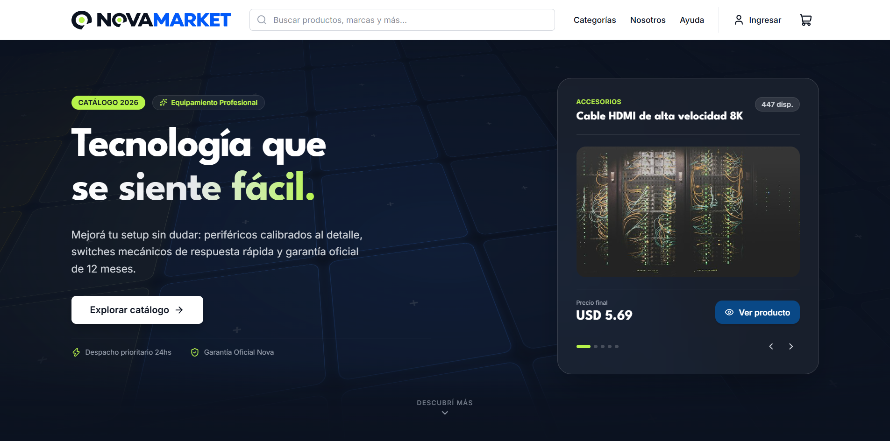
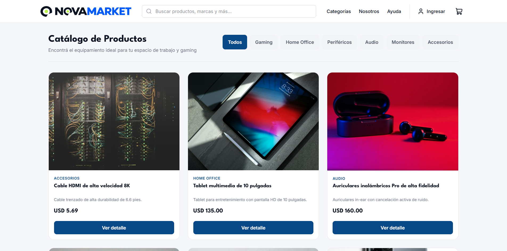
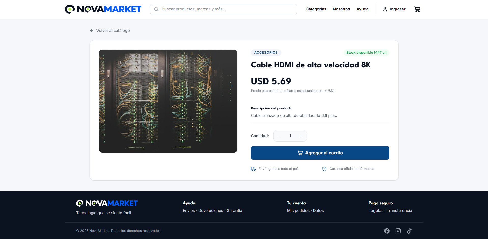
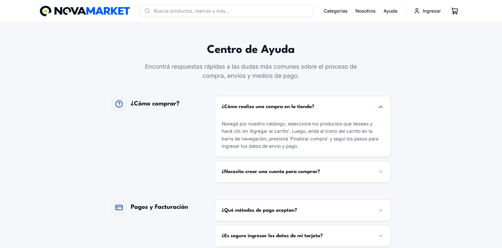
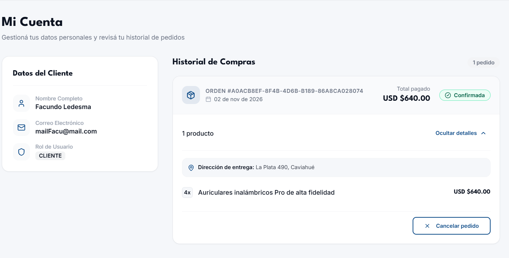
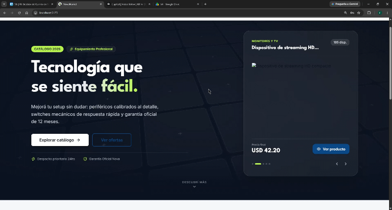

# NovaMarket - Frontend MVP

Este repositorio contiene el código frontend para el MVP de **NovaMarket**, un e-commerce tecnológico construido con **React**, **Vite**, **Tailwind CSS**, **React Router DOM** y **Axios**.

## 📸 Capturas de Pantalla

| Vista Principal (Home & Hero) | Catálogo de Productos |
| :---: | :---: |
|  |  |

| Detalle de Producto | Centro de Ayuda (FAQ) |
| :---: | :---: |
|  |  |

| Panel de Cuenta y Pedidos | Checkout / Carrito |
| :---: | :---: |
|  |  |

---


## 🛠️ Stack Tecnológico

- **Core:** React + Vite (JavaScript)
- **Estilos:** Tailwind CSS (Diseño responsivo Mobile-First)
- **Enrutamiento:** React Router DOM (Rutas públicas, dinámicas y protegidas)
- **Cliente HTTP:** Axios (Instancias centralizadas e interceptores JWT)
- **Iconografía:** Lucide React


## 📂 Estructura del Proyecto

El proyecto sigue una arquitectura modular para mantener el código ordenado y escalable. La organización principal dentro de `src/` es la siguiente:

```text
├── docs/               # Documentación y capturas para el README
│   └── screenshots/    # Imágenes y GIFs de demostración
├── public/             # Recursos estáticos públicos directos
├── src/
│   ├── assets/         # Logotipos SVG, isotipos, fuentes y recursos estáticos
│   ├── components/     # Jerarquía de componentes bajo Atomic Design
│   │   ├── atoms/      # Botones, loaders, badges e inputs base
│   │   ├── molecules/  # ProductCard, SocialLinks, HeroProductCard, AccordionItem
│   │   ├── organisms/  # Navbar, Footer, FeaturedProducts, CartModal, Layout
│   ├── const/          # Constantes y data estática (faqData.js, orderStatus.js)
│   ├── context/        # Estado global (AuthContext con persistencia en localStorage)
│   ├── hooks/          # Custom hooks con lógica de negocio desacoplada de la vista
│   │   ├── useProductsCatalog.js
│   │   ├── useProductDetail.js
│   │   ├── useLogin.js
│   │   └── useRegister.js
│   ├── pages/          # Vistas organizadas por dominio modular
│   │   ├── about/      # Información institucional y sobre nosotros
│   │   ├── account/    # Perfil, historial de compras y datos del usuario
│   │   ├── admin/      # Panel de administración y gestión interna
│   │   ├── auth/       # Vistas de autenticación (Login, Registro)
│   │   ├── checkout/   # Pasarela y flujo de confirmación de compra
│   │   ├── home/       # Vista principal (HeroBanner, destacados)
│   │   ├── products/   # Catálogo general y detalle de producto
│   │   ├── static/     # Páginas informativas estáticas (Centro de Ayuda / FAQ)
│   │   └── index.js    # Archivo barril para exportación centralizada de páginas
│   ├── routes/         # Enrutador central y guardias de navegación (PrivateRoute.jsx, AdminRoute.jsx)
│   ├── services/       # Conectividad con la API REST
│   │   ├── api.js      # Instancia base de Axios con interceptor de autenticación
│   │   ├── authService.js   # Endpoints de login y registro
│   │   ├── productService.js# Endpoints y filtrado de catálogo/productos
│   │   └── orderService.js  # Gestión de pedidos del usuario
│   ├── App.jsx         # Componente raíz con enrutador y providers globales
│   ├── index.css       # Configuración de Tailwind CSS (@theme, capas y animaciones)
│   └── main.jsx        # Punto de entrada de React en el DOM
├── .env.example        # Plantilla de variables de entorno para desarrollo
├── package.json        # Dependencias y scripts de ejecución
└── vite.config.js      # Configuración del bundler Vite
```


## 🧠 Decisiones de Arquitectura

Para el desarrollo del frontend de **NovaMarket** se priorizó una arquitectura limpia, desacoplada y escalable, evitando la sobreingeniería (como el uso prematuro de Redux) y asegurando que cada módulo tenga una responsabilidad única y predecible.

---

### 1. Separación Estricta de UI y Lógica de Negocio (Custom Hooks)
Las vistas (`pages/`) y componentes visuales son puramente presentacionales: reciben datos y disparan callbacks, sin ensuciar el JSX con llamadas a endpoints o transformaciones complejas de datos.

* **Patrón Contenedor/Hook:** La lógica de consumo de API, gestión de carga (`loading`), control de errores (`error`), sincronización con `searchParams` de la URL y filtrados reside exclusivamente dentro de Custom Hooks dedicados (`useProductsCatalog`, `useProductDetail`, `useLogin`, etc.).
* **Beneficio:** Facilita el mantenimiento, hace que los componentes visuales sean testeables de forma aislada y permite reutilizar flujos de datos completos entre distintas pantallas.

---

### 2. Gestión de Estado Global Pragmática (Context API + `localStorage`)
En lugar de introducir dependencias pesadas de manejo de estado global, se utilizó la API nativa de React para resolver necesidades transversales:

* **Persistencia Directa de Sesión:** El estado de usuario en `AuthContext` se inicializa y sincroniza sincrónicamente con `localStorage`. Esto elimina el parpadeo de carga (*flicker*) al refrescar el navegador y prescinde de llamadas bloqueantes de revalidación al montar la aplicación.
* **Aislamiento de Dominios:** La autenticación (`AuthContext`) y la gestión del carrito de compras se manejan en contextos independientes para evitar re-renderizados innecesarios en ramas del árbol de componentes que no consumen dicha información.

---

### 3. Capa de Servicios y Abstracción HTTP Centralizada (`Axios`)
Toda la comunicación externa con la API REST (`http://localhost:3000/api`) está desacoplada de la interfaz de usuario:

* **Instancia Centralizada (`services/api.js`):** La URL base se inyecta desde variables de entorno (`VITE_API_URL`).
* **Interceptores JWT:** Un interceptor de peticiones evalúa la existencia de un token en `localStorage` y adjunta de forma automática y transparente la cabecera `Authorization: Bearer <token>` únicamente cuando es necesario.
* **Servicios por Dominio:** Las peticiones se agrupan semánticamente en `authService`, `productService` y `orderService`, normalizando las respuestas para que los hooks consuman payloads limpios sin lidiar con los envoltorios internos de Axios (`response.data`).

---

### 4. Sistema de Diseño Modular (Atomic Design)
La interfaz de usuario se descompone en niveles jerárquicos de complejidad para maximizar la reutilización y consistencia visual:

* **Átomos (`components/atoms/`):** Elementos mínimos indivisibles con estados locales puramente visuales (ej. `Button`, `Input`).
* **Moléculas (`components/molecules/`):** Combinaciones de átomos que forman unidades funcionales reutilizables (`ProductCard`, `SocialLinks`, `AccordionItem`).
* **Organismos (`components/organisms/`):** Bloques visuales complejos que orquestan el layout o consumen contextos globales (`Navbar`, `Footer`, `HeroProductCard`).
* **Layouts (`components/layout/`):** Estructura envolvente maestra basada en `<Outlet />` de React Router DOM, garantizando un encabezado y pie de página uniformes a lo largo de toda la navegación.

---

### 5. Estilizado Predictivo y Tipado Visual (Tailwind CSS)
* **Tokens de Diseño Centralizados:** La paleta cromática de la marca (`primary`, `secondary`, `accent`, `highlight`), tipografías (`League Spartan`, `Inter`) y estados de interacción se configuraron a nivel de tema en `index.css`, garantizando consistencia en todo el proyecto.
* **Enfoque Mobile-First:** El diseño se construyó desde resoluciones móviles hacia pantallas de escritorio mediante breakpoints nativos (`md:`, `lg:`), aplicando optimizaciones específicas de encuadre (`object-cover`, proporciones calculadas y transiciones fluidas de CSS Grid).


## ⚙️ Instalación y Ejecución Local

Seguí estos pasos para clonar el repositorio, configurar el entorno y levantar la aplicación en tu máquina local.

### 1. Prerrequisitos

* **Node.js**: v18.x o superior (recomendado v20+ LTS).
* **Gestor de paquetes**: `npm` (incluido con Node.js), `yarn` o `pnpm`.
* **API Backend**: Servidor backend activo y escuchando peticiones (por defecto en `http://localhost:3000/api`).

Podés comprobar las versiones instaladas con:
```bash
node -v
npm -v
```

### 2. Clonar el Repositorio

```bash
git clone [https://github.com/Talently-Lab/s2620-NovaMarket.git](https://github.com/Talently-Lab/s2620-NovaMarket.git)
cd s2620-NovaMarket
```

### 3. Instalar Dependencias

```bash
npm install
```

### 4. Configurar Variables de Entorno

El proyecto incluye un archivo plantilla `.env.example` con la URL base de la API:

1. Creá tu archivo `.env` local copiando el de ejemplo:
   ```bash
   cp .env.example .env
   ```

2. Confirmá que el archivo `.env` apunte a tu servidor backend:
   ```env
   VITE_API_URL=http://localhost:3000/api
   ```

### 5. Iniciar el Servidor de Desarrollo

```bash
npm run dev
```

La consola te indicará el puerto activo (habitualmente `http://localhost:5173`). Abrí esa dirección en tu navegador para ver la app funcionando.

### 6. Comandos Disponibles

| Comando | Descripción |
| :--- | :--- |
| `npm run dev` | Inicia el servidor de desarrollo local con Vite (HMR activo). |
| `npm run build` | Compila y optimiza el bundle para producción en la carpeta `dist/`. |
| `npm run preview` | Levanta un servidor web local para probar el build de producción. |
| `npm run lint` | Ejecuta ESLint para analizar consistencia y errores de sintaxis. |


## 👨‍💻 Proyecto y Equipo

Este módulo de **Frontend** es parte del proyecto principal NovaMarket:
- 🔗 **Repositorio Raíz:** [Talently-Lab / s2620-NovaMarket](https://github.com/Talently-Lab/s2620-NovaMarket)

### Integrantes

- **Facundo Ledesma** — *Frontend Developer*  
  GitHub: [@FacuLedesmaBertalot](https://github.com/FacuLedesmaBertalot)

- **Carina Luna** — *UX / UI*  
  GitHub: [@xandcari](https://github.com/xandcari)

- **Fátima Paz** — *Project Manager*